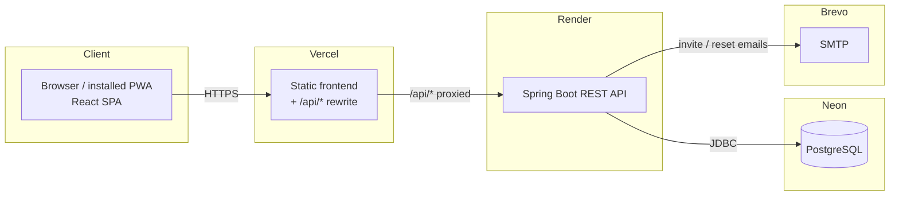

# Architecture

## Overview



The browser only talks to one origin (the Vercel domain). Vercel serves the static React build and proxies `/api/*` to the Spring Boot API, so the refresh-token cookie is first-party. See [ADR 0007](decisions/0007-free-tier-deployment.md).

Locally the same shape runs with Docker Compose: PostgreSQL, Mailpit (a fake SMTP server with a web inbox) and the two apps. The Vite dev server proxies `/api` to the backend.

## Tech stack

| Layer | Choice | Why |
|---|---|---|
| Backend | Java 25 (LTS), Spring Boot 4.1 (Web MVC, Security, Data JPA, Validation, Mail, Actuator) | Matches the company stack in the job description ([ADR 0001](decisions/0001-tech-stack.md)) |
| Build | Maven with the Maven Wrapper | Reproducible builds without a global install ([ADR 0009](decisions/0009-maven-wrapper.md)) |
| Database | PostgreSQL, Flyway migrations | Relational data with clear relations; versioned schema changes |
| Auth | JWT access token + rotating refresh token in an httpOnly cookie, bcrypt | Works for an SPA and a PWA without storing tokens in `localStorage` ([ADR 0003](decisions/0003-jwt-with-refresh-cookie.md)) |
| Email | Spring Mail + Thymeleaf templates; Mailpit locally, Brevo SMTP in production | Invite and reset links ([ADR 0004](decisions/0004-invite-link-onboarding.md)) |
| API docs | springdoc-openapi (Swagger UI) | Reviewers can try the API directly |
| Frontend | React, Vite, TypeScript (SPA) | React is listed in the job description; no SEO needs behind a login ([ADR 0011](decisions/0011-vite-spa-tanstack-router.md)) |
| Routing | TanStack Router (file-based, type-safe) | Next.js-style folders and layouts, guards in `beforeLoad` ([ADR 0011](decisions/0011-vite-spa-tanstack-router.md)) |
| UI | Tailwind CSS, shadcn/ui | Accessible components, quick to build, mobile-first |
| Data fetching | TanStack Query, axios | Caching, loading and error states; one place for token refresh |
| Forms | react-hook-form, zod | Typed validation shared by form and API calls |
| Lint | oxlint | Fast, near zero-config linter ([ADR 0010](decisions/0010-oxlint.md)) |
| PWA | vite-plugin-pwa | Manifest and service worker generation |
| Tests | JUnit 5, Mockito, Testcontainers, GreenMail, Vitest, Testing Library, Playwright | See [testing.md](testing.md) |
| CI | GitHub Actions | Runs on every pull request |
| Hosting | Vercel, Render, Neon, Brevo (all free tier) | See [deployment.md](deployment.md) |

## Repository layout

```
employee-portal/
├─ backend/                 Spring Boot API
│  └─ src/main/java/.../
│     ├─ auth/              login, refresh, logout, JWT, account tokens
│     ├─ user/              user entity, backoffice user management, self-service profile
│     ├─ loginhistory/      recording and querying login attempts (incl. backoffice view)
│     ├─ mail/              email sending and templates
│     ├─ common/            errors, pagination, utilities
│     └─ config/            security, CORS, OpenAPI, async, admin seed
├─ frontend/                React SPA / PWA
│  └─ src/
│     ├─ features/          auth, dashboard, profile, history, admin
│     ├─ components/        shared UI (shadcn/ui)
│     ├─ lib/               api client, auth store, utilities
│     └─ routes/            file-based routes (TanStack Router) and guards
├─ e2e/                     Playwright end-to-end tests
├─ docs/                    this documentation
├─ docker-compose.yml       local PostgreSQL + Mailpit (+ apps)
└─ .github/workflows/       CI
```

The backend is organised **by feature** rather than by layer: everything about login history lives in one package, which keeps related code together and makes features easy to find. Inside a feature, controllers handle HTTP, services hold the rules and transactions, and repositories access the database; entities never leave the service layer ([ADR 0013](decisions/0013-backend-package-structure.md)).

## Key design points

- **Stateless API, stateful refresh.** Access tokens are verified without a database lookup. Refresh tokens are stored (hashed) so they can be revoked on logout, deactivation or password change.
- **Roles.** `ADMIN` and `EMPLOYEE`, each with its own area: admins only use the backoffice (`/admin`), employees only use the dashboard (`/`). `/api/admin/**` requires `ADMIN`; `/api/me/**` (own profile, password, history) serves both roles ([ADR 0012](decisions/0012-separate-admin-and-employee-areas.md)).
- **User lifecycle.** `PENDING` (invited, no password yet) → `ACTIVE` → `INACTIVE` (can be reactivated). See [database.md](database.md).
- **Emails never block requests.** Emails are sent asynchronously after the transaction commits. If sending fails, the admin can copy the link from the backoffice.
- **Consistent errors.** Every error is an RFC 9457 `ProblemDetail` response. See [api.md](api.md).

## Frontend

- **Routes** live in `src/routes` and follow TanStack Router's file conventions: `_employee.tsx` is the pathless layout of the employee area (`/`, `/history`, `/profile`), `admin/_backoffice.tsx` the layout of the backoffice (`/admin/...`), and `login`, `admin/login`, `activate` and `reset-password` are public. `src/routeTree.gen.ts` is generated by the Vite plugin and committed so type checking works without a dev server.
- **Guards** run in each layout's `beforeLoad` (`src/lib/guards.ts`): no session goes to that area's sign-in page with `?redirect=`, and the other role goes to its own home. After sign-in the user returns to `redirect` only if it is a local path in their own area.
- **Session** (`src/lib/session.ts`): the access token and user live in memory only. On the first protected navigation after a reload, the app calls `/api/auth/refresh` once to restore the session from the httpOnly cookie.
- **API client** (`src/lib/api.ts`): axios adds the bearer token; on a 401 it refreshes once and retries. Concurrent 401s share one refresh, because a second refresh would present an already rotated token and be rejected. If the refresh fails, the router sends the user to sign in.
- **Data and forms:** TanStack Query for server state (cleared on sign-out so the next user never sees cached data), react-hook-form with zod schemas that mirror the backend rules, and field errors from the API shown next to the matching input.
- **Layout:** mobile first. A bottom tab bar on phones, inline navigation from the `sm` breakpoint up.
