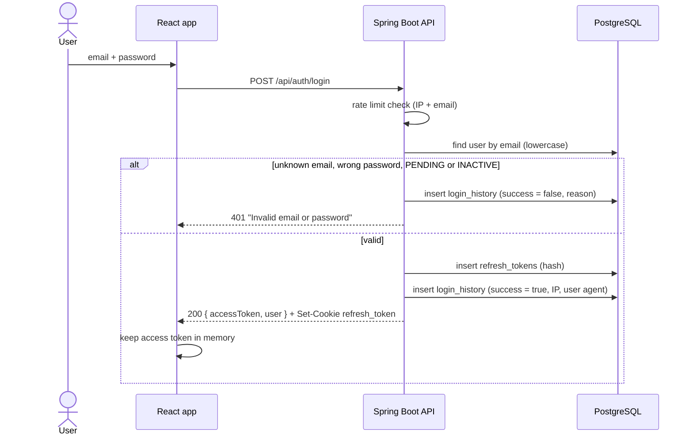
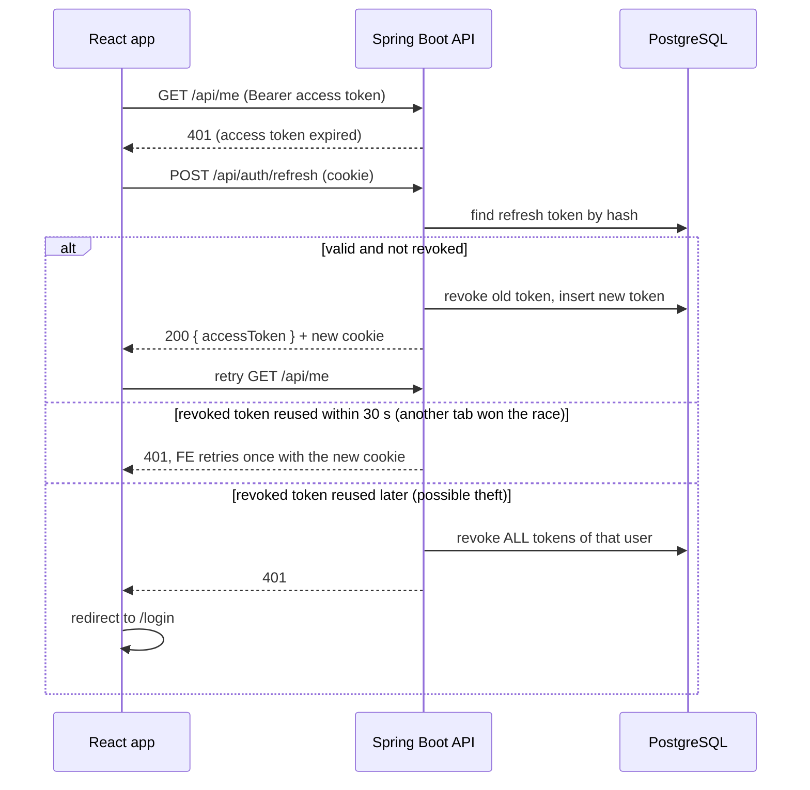
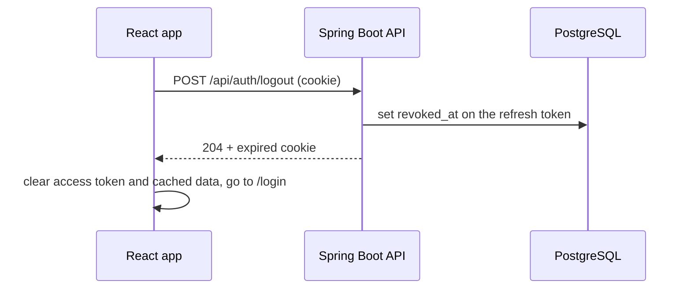
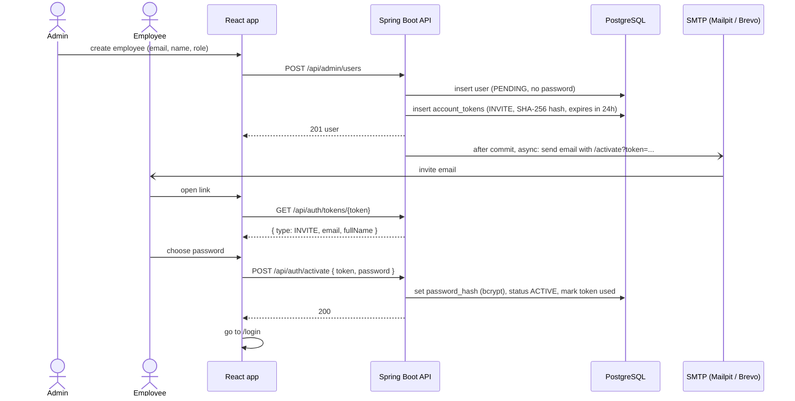

# Authentication Flows

Token storage on the client:
- **Access token**: kept in memory (a JavaScript variable), never in `localStorage`, so an XSS bug cannot read a long-lived token from storage.
- **Refresh token**: httpOnly, `Secure`, `SameSite=Lax` cookie with path `/api/auth`. JavaScript cannot read it, and it is only sent to the auth endpoints.

See [ADR 0003](decisions/0003-jwt-with-refresh-cookie.md) for the reasoning.

## Login

The response for a failed login is the same whatever the reason, so the endpoint cannot be used to discover which emails exist. The real reason is stored for the admin.

## Calling the API and refreshing

On page reload the in-memory access token is gone, so the app calls `/api/auth/refresh` once at startup to restore the session. Several requests failing at the same time share one refresh call.

## Logout

## Invite and activation

If the email does not arrive, the admin clicks **Resend invite**: a new token is issued, older ones are invalidated, and the link is shown so it can be copied.

## Password reset (admin-triggered)

Same flow as the invite, with type `RESET`, a 1-hour expiry, and `POST /api/auth/reset-password`. A successful reset revokes every refresh token of the user, signing out all devices.
