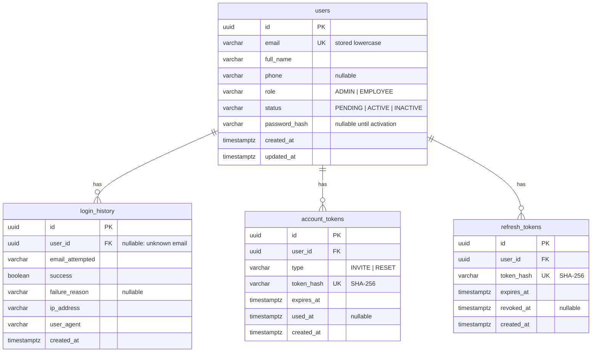
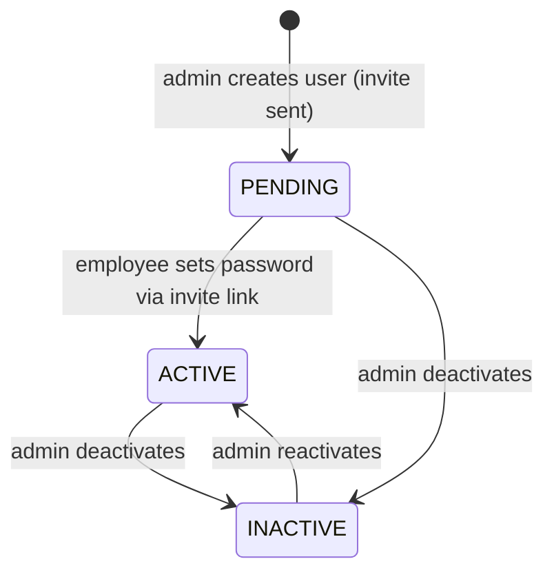

# Database

PostgreSQL. The schema is managed by Flyway migrations in `backend/src/main/resources/db/migration`.

## Entity relationship diagram

## Tables

### `users`
Every account, admin or employee. `role` decides the area: `ADMIN` uses only the backoffice, `EMPLOYEE` only the dashboard ([ADR 0012](decisions/0012-separate-admin-and-employee-areas.md)).
- `email` is unique and normalised to lowercase so `Budi@x.com` and `budi@x.com` are the same account.
- `password_hash` (bcrypt) is `NULL` while the user is `PENDING`, because employees set their own password through the invite link.
- Users are never deleted, only set to `INACTIVE` ([ADR 0006](decisions/0006-no-hard-delete.md)).

**Status lifecycle**

### `login_history`
One row per login attempt, successful or not ([ADR 0005](decisions/0005-login-history-includes-failures.md)).
- `user_id` is `NULL` when the email does not belong to any account; `email_attempted` still records what was typed.
- `failure_reason`: `INVALID_CREDENTIALS`, `ACCOUNT_PENDING`, `ACCOUNT_INACTIVE`, `WRONG_PORTAL` (correct credentials on the other role's login page) or `RATE_LIMITED`. This is stored for the admin; the API response to the client is always generic.
- Index on `(user_id, created_at DESC)` for "my history" pages, and on `created_at DESC` for the admin view.
- Rows are append-only. They are never updated by the application.

### `account_tokens`
One-time tokens for invites (24 hours) and password resets (1 hour).
- Only the **SHA-256 hash** of the token is stored. The plain token exists only in the email link, so a database leak does not expose usable links.
- `used_at` marks the token as consumed. Issuing a new token of the same type invalidates older unused ones.

### `refresh_tokens`
Refresh tokens issued at login (7 days).
- Stored as SHA-256 hashes.
- Rotated on every refresh: the old row gets `revoked_at`, a new row is inserted. If a revoked token is presented again (reuse) more than 30 seconds after it was rotated, all of that user's refresh tokens are revoked. Within those 30 seconds the request is only rejected; this covers two browser tabs refreshing at the same moment.
- Logout, deactivation and password change set `revoked_at` on the relevant rows.
